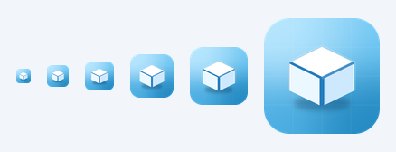

# 桌面盒子 (DeskBox)

一个常驻 Windows 桌面的小组件容器：**单个进程托管多个"盒子"**，每个盒子可独立开关，
按 `Win+D` 返回桌面后盒子仍停留在桌面。



## 内置盒子

| 盒子 | 功能 |
|---|---|
| **余额盒子** | DeepSeek API 余额、今日 / 本月消耗，以及最近 24 小时余额趋势面积图 |
| **快捷键盒子** | 键盘快捷键速查表，可直接在盒子上增删改；焦点在快捷键框时按键自动捕捉 |

## 特性

- **单进程多窗口** —— 一个 exe、一个消息循环，托管多个盒子
- **托盘统一管理** —— 右键托盘图标：勾选 / 取消各盒子、开机自启、退出
- **常驻桌面** —— Win+D 显示桌面后仍可见（拒绝最小化 + 去除隐藏标志 + 2 秒看门狗三层防护）
- **窗口记忆** —— 自动记住每个盒子的位置、尺寸、背景色、透明度、字体颜色
- **原生渲染** —— C++ / Direct2D / DirectWrite，静态 CRT，无运行时依赖

## 构建

需要 Visual Studio 2022（MSVC）：

```bat
build.bat
```

产物：`DeskBoxApp.exe`

## 首次运行前准备

程序从 **exe 同目录** 读取数据文件（缺失时用默认值 / 空列表，不会崩溃）：

| 文件 | 说明 |
|---|---|
| `apikey.txt` | DeepSeek API Key（第一行）；也可改用环境变量 `DEEPSEEK_API_KEY` |
| `shortcuts.txt` | 快捷键列表，格式 `按键 = 功能描述`，每行一条 |
| `history.csv` | 余额历史，**自动生成** |
| `boxes.cfg` | 哪些盒子启用，**自动生成** |
| `deskbox.cfg` / `keybox.cfg` | 各盒子的位置、尺寸、外观，**自动生成** |

```bat
:: 填入你的 Key
copy apikey.example.txt apikey.txt
:: 生成初始快捷键列表
copy shortcuts.sample.txt shortcuts.txt
```

## 使用

- **托盘图标**（Win11 默认收纳在 `^` 溢出区）右键 → 勾选盒子 / 开机自启 / 退出
- **拖动**盒子空白处移动，拖动右下角缩放
- **右键盒子** → 外观设置（背景色 / 字体颜色 / 透明度）、字号调整
- **快捷键盒子** → 点右上角 `+` 添加（焦点在快捷键框时直接按组合键即可捕捉），点条目删除

> `Fn` 是键盘固件层按键，系统收不到，需要手动输入 `Fn+...`。

## 目录结构

```
main.cpp           应用入口：盒子注册表、托盘、消息循环
box_balance.cpp    余额盒子（WinHTTP 请求 + 趋势绘制）
box_shortcut.cpp   快捷键盒子（列表编辑 + 低级键盘钩子捕捉）
build.bat          构建脚本
deskbox.ico        托盘图标（16~256 多尺寸）
apikey.example.txt API Key 模板
shortcuts.sample.txt 快捷键样例
```

## 新增一个盒子

1. 新建 `box_xxx.cpp`，导出两个函数：

   ```cpp
   HWND XxxBox_Create();   // 建窗口、初始化、首次渲染，返回 HWND（不要起消息循环）
   void XxxBox_Destroy();   // 销毁窗口，必须幂等
   ```

2. 在 `main.cpp` 的 `g_kinds` 表加一行：

   ```cpp
   { L"我的盒子", "xxx", XxxBox_Create, XxxBox_Destroy },
   ```

3. 把 `box_xxx.cpp` 加进 `build.bat` 的 `cl` 命令。

托盘菜单会自动出现这一项。

## 隐私说明

本仓库**不包含任何个人数据**。以下文件已写入 `.gitignore`，不会被提交：

- `apikey.txt` —— API 密钥
- `shortcuts.txt` —— 个人快捷键清单
- `history.csv` —— 余额历史
- `*.cfg` / `*.log` —— 运行时配置与日志
